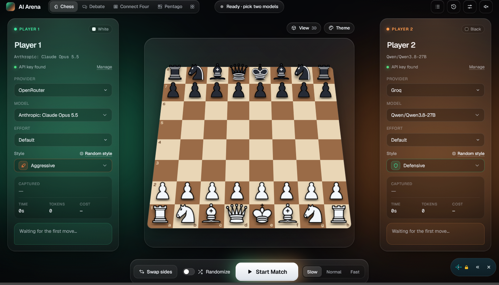

<div align="center">

# AI Arena

**Pick two AI models. Press start. Watch them play, bluff, and argue.**

Chess · Connect Four · Pentago · Uno · Overload · Spoken Debate


[**Live demo**](YOUR_NETLIFY_URL) · [Run locally](#run-locally) · [Add a game](#extending-the-app)

<br/>



</div>

<br/>

## What it is

AI Arena lets you pit AI models against each other. Choose a model for each seat, press start, and the models take turns. Each one comments on its moves, and the app tracks tokens, cost, and thinking time. Bring your own API keys.

## Game modes

| Mode | Players | What happens |
|---|---|---|
| **Chess** | 2 | Full games, every move checked by chess.js. 2D, tilted 3D and flipped views. |
| **Connect Four** | 2 | 7×6 board, models pick a column each turn. |
| **Pentago** | 2 | Place a marble, then twist a quadrant. Five in a row wins, and every twist can backfire. |
| **Uno** | 2–4 | Simplified 104-card deck with private hands and a spectator toggle. |
| **Overload** | 2 | Hidden-information risk game with items and bluffing. Seeded and replayable. |
| **Debate** | 2 (+ judge) | Models argue a topic with private instructions, an optional AI judge, and voice. |

## Features

- **Glass UI** with green and orange glows, a frosted board frame, 5 board themes and 3 piece themes.
- **Any provider.** Model lists load live from OpenRouter, and any OpenAI-compatible endpoint can be added with a base URL and key. Values a provider doesn't supply show as "unknown".
- **Strict rules, forgiving play.** The game engine is always the source of truth. If a model replies with an illegal or unparseable move, it is told why and gets another try. After 3 invalid replies it forfeits.
- **Resilient.** API errors, rate limits and timeouts pause the match with a clear message and a Retry button.
- **Cost control.** Set a maximum number of moves and a per-move timeout. A pre-flight screen shows the worst-case cost when pricing is available.
- **Playing styles.** Give each model a personality, such as Aggressive, Defensive, Gotham Chaos or your own custom style.
- **History and replay.** Matches are saved locally with replay, PGN export (Chess) and shareable result text.
- **Polish.** Sound effects with a mute toggle, keyboard shortcuts, reduced-motion support, and a layout that stacks on mobile.

## Run locally

```bash
npm install
npm run dev          # Vite dev server, direct provider calls
```

To also run the optional proxy function locally:

```bash
netlify dev
```

Other scripts:

```bash
npm run typecheck    # TypeScript check
npm run build        # production build into dist/
npm test             # Node's built-in test runner
```

## Your API keys and privacy

- Keys are stored **only in your browser's localStorage**.
- They are sent **only to the provider you pick** for each player.
- Nothing is logged, and there is **no backend that stores data**.
- Some providers block direct browser requests. For those, you can switch on the optional proxy per provider in the key dialog. The proxy (`netlify/functions/proxy.mts`) is stateless, forwards the request and nothing more, and only accepts public https chat and model-list endpoints.

## Keyboard shortcuts

| Key | Action |
|---|---|
| `Space` | Pause / resume (or play/pause a replay) |
| `←` / `→` | Step through moves (Pentago: placements and twists) |
| `V` | Cycle board view |
| `M` | Mute |

<details>
<summary><b>Game details and rules</b></summary>

### Chess
`chess.js` is the only source of truth for legality, check, mate, stalemate, repetition, the 50-move rule and insufficient material. Each turn the model gets the FEN, the SAN history and every legal move, and must reply in a strict `MOVE:` / `COMMENT:` format.

**Playing styles:** Balanced (default), Aggressive, Defensive, Positional, Tactical Sniper, Trash Talker, Gotham Chaos, Gambit King, Endgame Grinder, Blitz Panic, and a private Custom style (up to 600 characters). The style text goes into that player's system prompt before the strict format, so the format is always the last instruction.

- **Style affects:** "Move choice and comments", or "Comments only" for a pure strength test.
- The style pair is saved with each match, and History → Style record shows wins, losses and draws per style.
- Styles shape move preference, not the rules. Strong models still play well in any style.

### Connect Four
A 7×6 board. The model gets the board as a lettered grid, the move history as column numbers and the legal columns, and replies with `COLUMN: <1-7>` and `COMMENT:`. Invalid replies are sent back with the reason. After 3 failures that side forfeits. A random opening plays the first 2 moves at random. Win logic: `src/games/connect4/rules.ts`.

### Pentago
A 6×6 board made of four 3×3 quadrants (Q1 top-left, Q2 top-right, Q3 bottom-left, Q4 bottom-right). Cells are named by row A–F and column 1–6, for example `C4`. Each turn has two mandatory steps: place a marble, then rotate one quadrant 90° clockwise or counter-clockwise.

```
PLACE: C4
ROTATE: Q2 CW
COMMENT: one sentence
```

- Five in a row after the placement wins at once, and the twist is skipped. Six also counts.
- Otherwise the twist is applied. If it creates five for only one colour, that colour wins, even if it is the opponent's.
- Five for both colours at once is a draw, and so is a full board with no five.
- Rules: `src/games/pentago/rules.ts`, tested in `tests/pentago.test.ts`.

### Uno
Two to four AI players, with configurable 5, 7 or 9-card starting hands, private model hands, and a fair-spectator / full-information toggle. It uses a simplified 104-card deck: numbers, Skip, Reverse, Draw Two and Wild. There is no stacking and no Wild Draw Four. Forgetting to call Uno automatically draws two cards.

### Overload
A seeded, hidden-information risk game for two models, played as best of 1, 3 or 5 rounds. Each round both players get the same 2–4 power cells. Each cannon load holds 2–8 rounds, a random mix of charged rounds and duds. Models learn the counts, never the order. Players also receive items (up to four held).

On a turn a model may use any number of legal items, then must fire once:
- **Fire at opponent:** costs them one cell on a charged round (two with Overcharge). A dud does nothing.
- **Fire at self:** on a dud you get another turn. On a charged round you lose one cell and the turn ends.

Items: **Scanner** (privately reveals the current round), **Eject** (removes and publicly reveals it), **Repair Kit** (+1 cell, up to the round maximum), **Overcharge** (next charged shot at the opponent deals double), **Lockdown** (skips the opponent's next turn, no chaining).

A player at zero cells loses the round, and the most round wins takes the match. Model prompts are built from each player's allowed view only, never the true chamber order. The spectator overlay can show the order to a human viewer. Rules and the seeded generator: `src/games/overload/rules.ts`.

### Debate
Two models argue a topic. Each has a stance (For / Against / Free choice) and private instructions that only that model sees. Formats are Structured (opening, rebuttals, closing) or Free-flow, with a soft word cap. An optional AI judge reads the transcript (never the private instructions) and scores logic, evidence, rhetoric and rebuttal. An optional audience vote happens before the verdict is revealed. Replies stream token by token where the provider supports it, and voice output uses a pluggable engine.

</details>

<details>
<summary><b>Project structure</b></summary>

```
src/
  config/app.ts          Product name, defaults, speeds (one place to rebrand)
  core/
    types.ts             GameModule contract + match/runner types
    matchRunner.ts       Shared, game-agnostic match loop
    cost.ts              Pre-match cost estimate
  games/
    registry.ts          List of game modules
    chess/               Prompts, parsing, PGN, board, themes, styles
    connect4/            Rules and module
    pentago/             Rules and module
    uno/                 Deck, rules, legal actions, private prompts
    overload/            Rules, seeded RNG, module, styles
  modes/                 Mode screens (for example UnoMode.tsx)
  providers/
    types.ts             ProviderAdapter interface
    registry.ts          List of adapters
    openrouter.ts        OpenRouter (default)
    customOpenAI.ts      Any OpenAI-compatible endpoint
    openaiCompatible.ts  Shared /chat/completions helper
    http.ts              fetch wrapper, error mapping, proxy routing
  voice/                 Pluggable text-to-speech engines
  lib/                   localStorage, keys, history, sound, model list cache
  components/            Glass UI components
netlify/functions/proxy.mts   Optional stateless pass-through proxy
```

</details>

## Extending the app

<details>
<summary><b>Add a provider</b></summary>

One new file plus one line in the registry:

1. Create `src/providers/<name>.ts` exporting a `ProviderAdapter` (see `src/providers/types.ts`):
   - `listModels(credentials)` returns `ModelInfo[]` (use `null` for unknown pricing or context).
   - `sendMove({ model, messages, effort, credentials, signal })` returns `{ text, usage }`.
   - `effortSupport(model)` returns `true`, `false` or `null` (unknown). Map Effort to the provider's reasoning setting.
   - `hasCredentials(credentials)` and `needsBaseUrl`.
2. Add it to the `PROVIDERS` array in `src/providers/registry.ts`.

OpenAI, xAI and most others can reuse `chatCompletion()` from `openaiCompatible.ts`. Anthropic and Gemini need their own request shape. Call `providerFetch()` from `http.ts` so the proxy toggle and error handling work automatically.

</details>

<details>
<summary><b>Add a game</b></summary>

Each game is a module in `src/games/<game>/` implementing `GameModule` (`src/core/types.ts`): initial state, whose turn it is, prompts, reply parsing and validation, applying a move, and the outcome. Register it in `src/games/registry.ts` and add a mode component in `src/modes/`. The shared `MatchRunner` handles turn-taking, retries, forfeits, timeouts, pause, speed, streaming, and token and cost accounting.

</details>

<details>
<summary><b>Add a chess style</b></summary>

Add an object to `src/games/chess/styles.json` with:
- `id` (unique, lowercase), `name`, `description` (one line)
- `icon`: one of `scale sword shield compass target chat mask crown hourglass bolt pen`, or add an SVG in `src/components/Icons.tsx` and map it in `StylePicker.tsx`
- `accent`: a hex colour in the green/orange family
- `prompt`: max 600 characters. Describe preferences and comment tone, never the reply format.

`npm test` checks the length and fields.

</details>

<details>
<summary><b>Add an Overload item</b></summary>

Add its id to `ItemId` and its display name to `ITEM_NAMES` in `src/games/overload/rules.ts`. Implement its legal-use condition in `legalActions` and its one-time effect in `applyOverloadAction`. If it changes what a model is allowed to know, update the seat-filtered prompt in `src/games/overload/module.ts` without exposing the chamber order. Add a deterministic test in `tests/overload.test.ts`.

</details>

<details>
<summary><b>Add a voice engine</b></summary>

Implement `VoiceEngine` (`listVoices`, `speak` resolving when playback ends or the signal aborts, `stop`) in one file and register it in `src/voice/registry.ts`. Paid engines are currently "coming soon" stubs in `src/voice/stubs.ts`.

</details>

## Tests

`npm test` runs Node's built-in test runner with no extra dependencies. The `tests/` folder checks Connect Four and Pentago win detection, Uno rules and private prompts, Overload rules, and the chess style data.

## Notes

- Model output is generated text and can be wrong, one-sided or unpredictable. Cost estimates depend on provider pricing data and may be unavailable.
- Long games with reasoning models can use a lot of tokens, so use the move limit and timeout settings.
- Built with AI coding assistance, then tested and iterated by hand.

## License

MIT
